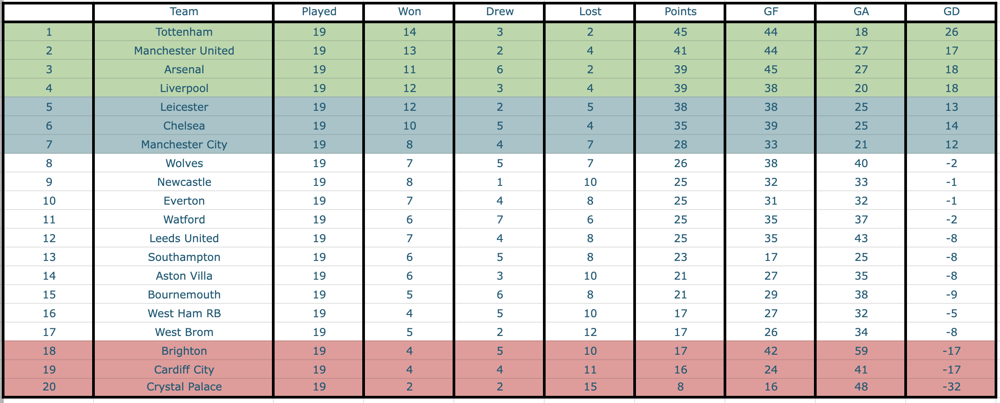
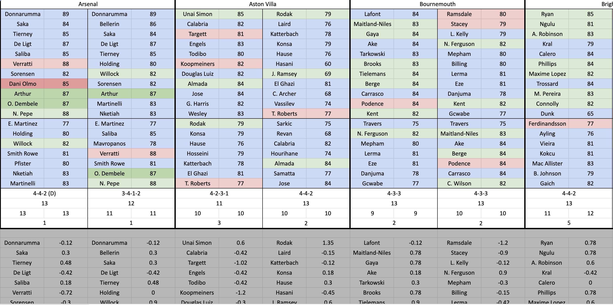
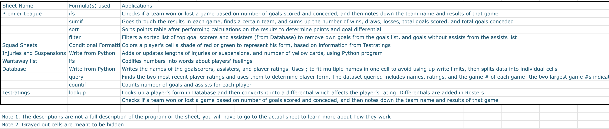

# Hypothetical PL

A Python match engine that simulated four Premier League seasons of 38 gameweeks each, writing results into Google Sheets, where formulas built league tables, top-scorer charts and player form.

The league ran from April 2019 to March 2020. Rosters were fantasy and intentionally unrealistic, including 49 made-up players marked "(N)".

**Live workbook (view only):** [HPL on Google Sheets](https://docs.google.com/spreadsheets/d/1QxcviNd2_41C7n80YJP0qMjTAd_sKYSXLIig0c9iI7s/edit?usp=sharing)

<!-- Screenshots to be added -->




## How the engine works

All of the logic lives in `soccer.py`.

- **Team strength:** the sum of the 11 starters' FIFA ratings plus half of the 3 substitutes' ratings, with +20 for the home team (`get_scoreline`).
- **Tactics:** each team picks a tactic number on its roster sheet. 1–3 work like rock-paper-scissors, and the winning side gets a rating boost and a chance of extra goals. 4 is park the bus (fewer goals), and 5 is all-out attack (more goals). See [Tactics](#tactics) below.
- **Scorelines:** drawn from a probability table chosen by the rating gap between the two teams. When the gap is large there is a chance of a thrashing (+3 goals for the stronger side).
- **Scorers and assisters:** weighted random "probability bins" built from each player's position and rating, so forwards score more often than defenders and goalkeepers never score (`determine_goal_data`). Penalties, free kicks and own goals are drawn separately. A goal is unassisted when the scorer and the assister are the same player.
- **Player ratings:** points per match in the style of Fantasy Premier League (goals, assists, clean sheets and so on), plus a man of the match and a worst player of the match.
- **Also simulated:** yellow and red cards, injuries, fatigue, two-leg cup ties, penalty shootouts and goal-by-goal commentary.

## What the Google Sheet does

The script reads rosters from the workbook with `gspread` and writes results back. Values are packed into single cells with `;` separators to stay under the Sheets API write limits, and sheet formulas split them back out. In the workbook:

- `IFS` decides win, draw or loss for each result.
- `SUMIF` builds team totals.
- `SORT` orders the league table.
- `FILTER` produces the top scorer and assist lists.
- `QUERY` pulls each player's two most recent ratings, which together give their form.
- `LOOKUP` turns form into a rating adjustment.
- Conditional formatting colors players by form.

The script uses three worksheets: `Rosters` (squads, formations, set-piece takers, tactics), `Database` (scorers, assisters and ratings written after each gameweek) and `Injuries and Suspensions`.

## Setup

1. Create a Google Cloud service account with the Google Sheets and Google Drive APIs enabled, and download its JSON key.
2. Share your copy of the workbook with the service account's email address (edit access).
3. Point the script at the key:
   ```bash
   export HPL_CREDENTIALS=/path/to/your-key.json
   ```
   If `HPL_CREDENTIALS` is not set, the script looks for `client_secret.json` in the repo folder. `.gitignore` excludes it, so it won't be committed.
4. If your workbook is not named `HPL Season 4`, set `HPL_WORKBOOK` to its name.
5. Install dependencies:
   ```bash
   pip install -r requirements.txt
   ```
6. Run a gameweek:
   ```bash
   python soccer.py tot eve ars mci bou sou
   ```
   Teams are paired in order (`tot` hosts `eve`, `ars` hosts `mci`, and so on). With no arguments it plays those six teams. Before playing, the script waits for you to press Enter to confirm lineups and venue.

Team codes are listed in `teams_map` at the top of `soccer.py`. Adding a trailing `0` to a code applies fatigue (each `0` lowers every player's rating by 1), and a trailing `1` uses the team's B squad.

## Customization

These sections come from the original manual (`docs/Manual.pdf`). The manual refers to line numbers and a workbook called "Hypothetical PL 2", and both are now out of date. Function names are used here instead.

### Formation order

Enter players on the roster sheet in this order so the scorer and assister weighting works properly. Other orders still run, but center backs and defensive midfielders may end up topping the scoring charts. Starred (*) players are the most attacking player in that position. Wide players go clockwise (RB, LB, LW, RW).

| Formation | Order |
|---|---|
| 4-2-3-1 | GK, RB, LB, CB, CB, DM, DM, AM, LW, RW, ST |
| 4-4-2 | GK, RB, LB, CB, CB, CM, CM, LM, RM, ST, ST* |
| 4-3-3 | GK, RB, LB, CB, CB, CM, CM, CM*, LW, RW, ST |
| 4-4-2 D / 4-3-1-2 | GK, RB, LB, CB, CB, CM, CM, CM*, AM, ST, ST* |
| 3-4-3 | GK, CB, CB, CB, RM, LM, CM, CM, LW, RW, ST |
| 3-5-2 | GK, CB, CB, CB, RM, LM, DM, CM, CM*, ST, ST* |
| 3-4-1-2 | GK, CB, CB, CB, RM, LM, CM, CM, AM, ST, ST* |
| 5-2-3 | GK, RWB, LWB, CB, CB, CB, CM, CM, LW, RW, ST |
| 5-3-2 | GK, RWB, LWB, CB, CB, CB, CM, CM, CM*, ST, ST* |
| 5-2-1-2 | GK, RWB, LWB, CB, CB, CB, CM, CM, AM, ST, ST* |

Formation names that match a key in `formations_map` use its preset. Any other `a-b-c-d` string is split on the dashes.

### Tactics

Tactics are handled in `get_scoreline`. In this version of the code:

- **1, 2, 3:** rock-paper-scissors. When both teams pick from 1–3 and one tactic beats the other, the winner gets +20 rating and a small chance of extra goals.
- **4 (park the bus):** if either team picks it, each side has a chance of scoring 2 fewer goals. The chance depends on that team's share of the combined rating.
- **5 (all-out attack):** if either team picks it, each side has a chance of scoring 2 more goals, again weighted by rating.
- **0 (no tactic):** the team loses 33 rating points and the opponent may get bonus goals.

The original manual describes an earlier scheme, with tactics 1–6 as rock-paper-scissors pairs, 7 as park the bus and 8 as all-out attack. The code above is what the final seasons ran.

### Tiebreakers

`play_league` sorts the table by points, then goal difference, then goals scored, as in the Premier League. To change this, edit the comparisons in the sorting loop at the end of `play_league`. The table columns are: 2 wins, 3 draws, 4 losses, 5 points, 6 goals for, 7 goals against, 8 goal difference. `play_league` prints the top 5 scorers and assisters and the top 15 rated players. Remove the `[:5]` or `[:15]` slices to see everyone.

### Fixtures

`fixtures` builds a double round-robin (every team plays every other team home and away) using the circle method. To get a single round-robin, remove the `all_fixtures.append(return_matches)` line.

### Game modes

The `__main__` block at the bottom of `soccer.py` calls `play_week`. To run another mode, swap in a different function:

- `play_week(teams, big)`: one league gameweek. Writes scorers, assisters and ratings to the `Database` sheet and cards and injuries to `Injuries and Suspensions`.
- `play_leg(teams, big)`: one leg of a two-leg cup tie (draws stand, no shootout).
- `play_cup_round(teams, big)`: a single-match knockout round or final. Draws go to a penalty shootout.
- `play_league(teams)`: simulates a full double round-robin season and prints the table and leaderboards. It needs an even number of teams.

For a neutral venue, remove the `home_total_fifa_rating += 20` line in `get_scoreline`.

## Notes

- Rosters are fictional and intentionally unrealistic. These were created by real users doing transfers with each other, while I commissioned the other transfers.
- Written in 2019–2020. The fixtures function is adapted from a Stack Overflow answer.
- `oauth2client` is deprecated. The script still uses it, and could move to `gspread.service_account(filename=...)` with `google-auth`. That switch was left out because it could not be tested without credentials.
- `HPL Season 4.xlsx` is a copy of the season 4 workbook.

### 2026 cleanup

- Replaced the hardcoded local credentials path with the `HPL_CREDENTIALS` environment variable and added a `.gitignore`.
- Replaced an informal comment with a proper credit for the fixtures function.
- Fixed a bug where three formations (`3-5-1-1`, `5-4-1 (D)`, `5-4-1`) were defined as sets instead of lists, which crashed the script for teams using them.
- Wrapped the run code in `if __name__ == "__main__":` and added optional command-line team codes.
- Moved the workbook name to one `WORKBOOK_NAME` setting (`HPL_WORKBOOK`) and opened the workbook once instead of three times.
- Added `requirements.txt`, this README, and moved the manual to `docs/`.
